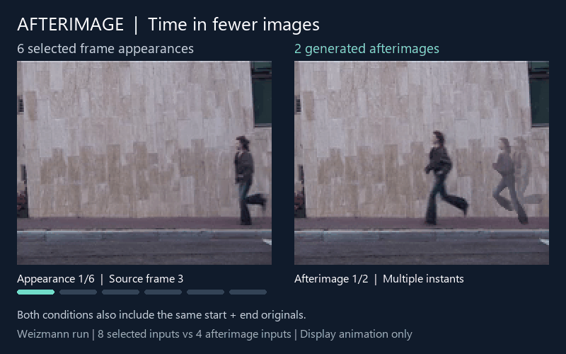
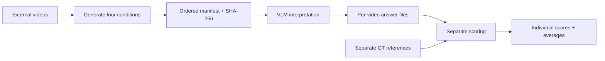

# Afterimage: video event interpretation with fewer visual inputs

[한국어 안내](README.ko.md) · [Run the pipeline](#1-environment) · [Verification](#verification-status) · [Schemas](docs/SCHEMA.md)



**Six selected frame appearances become two afterimages.** Including the same first and last originals, this example uses **8 vs 4 input images**. Repeated silhouettes represent the same person at different instants. The animation presents preserved selected frames beside the actual composites; it does not show continuous reconstruction or a VLM result. Frame 18 occurs twice by design. Display timing is illustrative.

*Example: Weizmann Actions, run sequence. Credit: Blank, Gorelick, Shechtman, Irani and Basri, [Actions as Space-Time Shapes](https://www.wisdom.weizmann.ac.il/~vision/SpaceTimeActions.html), ICCV 2005. [Exact example hashes and transformations](assets/PROVENANCE.json). Source footage remains under its original rights; this small illustration does not license redistribution of the dataset.*

## Research in brief

고정 CCTV의 주요 사건과 시간적 전개를 해석하면서 시각적 입력량을 줄이는 연구입니다. 비디오에서 잔상과 비교 프레임을 생성하고, GT를 보여주지 않은 VLM 해석 결과를 저장한 뒤, 별도 GT로 채점합니다. 이 저장소는 재현용 코드와 실행 절차를 제공하며, 본실험 완료나 잔상의 우수성을 주장하지 않습니다.

We study whether a sequence of afterimages can preserve the main event and meaningful temporal development while reducing visual input. The pipeline compares four representations on **303 videos: Weizmann 93, UT-interaction 120, KISA 90**. GT1 evaluates event summaries; GT2 evaluates major temporal development in KISA. Input counts alone do not establish a token-cost reduction or an accuracy gain; those require measured experiments.



**Status:** three-video live diagnostic completed: 32 descriptions and 32 scores, both models and four conditions. The full three-repeat experiment has not started: the sequential Claude estimate exceeds the $100 provider budget, and large-input transport needs further verification. No API calls are made by the default workflow. Generation is currently validated on Windows/CUDA; two cold-generated videos match all four existing conditions. This is not a 303-video cold verification or a fresh-machine validation.

## Reproduce the workflow

Clone the repository, then follow steps 1–7 below:

```powershell
git clone https://github.com/Jeon-minseong/Afterimage.git
cd Afterimage
```


This repository implements the sequence **videos → afterimages and comparison frames → VLM descriptions → separate GT-based scoring → tables**. The method code is C41/common_split; proposed API models, judge rubric and repetition counts remain subject to the authors' final experiment decision.

The scientific task is to interpret the main CCTV event and its meaningful temporal development with fewer visual inputs. GT1 concerns the main event summary; GT2 concerns major temporal development in KISA. Exhaustive micro-action recovery is not the task.

## What is included

```text
afterimage/
  generate.py       # video-directory entry point and four-condition manifests
  engine/           # preserved generation implementation and pinned YOLO source
  providers.py      # OpenAI / Claude HTTP adapters; keys come from environment
  experiment.py     # request plans, inference, independent scoring, aggregation
  metrics.py        # ordered input counts, measured tokens, paired score comparisons
  __main__.py       # command-line interface
configs/
  experiment.json   # proposed model/settings and prompt hashes
  dataset_catalog.json # 303 video IDs, source hashes and generation profiles
  weights.json      # required model-asset hashes; no binary weights
gt/references.json  # separate GT1/GT2 reference data, never sent during inference
prompts/            # interpretation prompts and a proposed scoring rubric
tests/              # offline end-to-end tests, no API usage
docs/               # provenance, data schema, release constraints
validation/         # saved local verification results, not experimental outcomes
```

Videos, model weights, API keys, caches and generated results are external or git-ignored. Downloading or distributing datasets/model weights requires following their original terms; this repository does not grant redistribution rights. See [release constraints](docs/RELEASE_STATUS.md).

## 1. Environment

Generation currently supports **Windows, Python 3.10, NVIDIA CUDA**, with more than 5 GB free GPU memory required by the preserved engine. This is the documented baseline, not a claim of Linux/macOS or fresh-machine validation. API inference/scoring use only the Python standard library (Python ≥3.10); GPU is not required for those stages.

PowerShell, from this repository directory:

```powershell
py -3.10 -m venv .venv
.\.venv\Scripts\Activate.ps1
python -m pip install torch==2.6.0 torchvision==0.21.0 --index-url https://download.pytorch.org/whl/cu124
python -m pip install -r requirements-generation.txt
python tools/verify_release.py
python -m unittest discover -s tests -v
```

`configs/environment.freeze.txt` records the fuller previously used Python environment. The YOLO source in `afterimage/engine/vendor` is the preserved 8.3.221 dependency; do not silently replace it with the newest release. OS, driver and wheel availability also affect a new installation. The command sequence has not yet been tested by installing everything on another computer.

## 2. Obtain videos and model assets separately

The study covers Weizmann 93, UT-interaction 120 and KISA 90 videos. `configs/dataset_catalog.json` maps exact source-video SHA-256 to stable IDs and generation profiles. Supply legally obtained matching source files under a directory, for example `C:\datasets\afterimage`. Filenames may differ: hashes identify known videos. Avoid duplicate copies of the same source in the directory.

Supply model assets under a separate `C:\models\afterimage` directory:

```text
yolo11n.pt
rmbg2/
  model.safetensors
  config.json
  birefnet.py
  BiRefNet_config.py
```

The engine verifies each file against `configs/weights.json`. Obtain the matching authorized assets from their upstream sources or an author-provided permitted asset distribution; a newer checkpoint with a different hash is not the pinned experiment. The current local project already has these assets. Model sources are listed in `configs/weights.json`; the weight binaries are intentionally absent from the source release.

## 3. Generate inputs from a video-directory path

```powershell
python -m afterimage generate --videos C:\datasets\afterimage --weights C:\models\afterimage --out runs/inputs
```

For a diagnostic subset, append `--ids v7e28bba5b470` (Weizmann run). Omit `--ids` to process all discovered videos. Known source hashes recover the benchmark IDs. Unknown videos receive content-derived IDs and a default generation profile, and require separately authored GT; that extension is not the 303-video benchmark reproduction.

The command starts with a fresh output directory and recomputes precursor flow, detections, tracks, flow, segments, selection, masks and composites. Historical signal/mask caches are not bundled or used. It writes `runs/inputs/manifest.json`, content-addressed PNGs, generation records and logs. It preserves order and duplicate appearances. The four conditions contain:

| Condition | Content | Images per video |
|---|---|---:|
| `uniform_observations` | Uniform original frames, matched to selected appearances | M+2 |
| `selected_sequence` | Original frames used in composition, with duplicates | M+2 |
| `afterimage` | Afterimage sequence | J+2 |
| `uniform_budget` | Uniform original frames, matched to composite count | J+2 |

Every condition includes beginning and ending original views. M counts frame **appearances**, not unique frames. J is the number of intermediate sequence images. Endpoint samples can also occur internally and are not removed.

An optional bridge imports the existing fixed project inputs without recomputing them:

```powershell
python -m afterimage import-fixed --project C:\path\to\20261026_Afterimage_Research --out runs/frozen_inputs
```

The imported manifest explicitly labels this as an import, not cold generation. Ordinary reviewers use `generate` or a separately released fixed-input bundle; the old author project is not required by the main workflow.

## 4. Prepare and review inference requests (no API calls)

```powershell
python -m afterimage validate --inputs runs/inputs
python -m afterimage prepare-inference --inputs runs/inputs --out runs/inference_plan --repeats 1
python -m afterimage run --plan runs/inference_plan --inputs runs/inputs --out runs/answers
```

The final command is a dry run. It prints the plan hash and request count. A full matching dataset gives 1,572 requests per model per repeat (GT1: 1,212; GT2: 360). Two models require 3,144 or 9,432 requests for 1 or 3 repeats. `--repeats 3` creates all three independent repeats; decide this before execution. A new plan hash is a distinct experiment and does not silently reuse another plan's responses.

The diagnostic settings are GPT-6.1 Sol / Claude Opus 5.5, medium, maximum 4,096 billable output tokens including reasoning, with `structured_output: true`. The API JSON schema enforces the output fields; it does not make the interpretation correct. GT1/GT2 afterimage prompts preserve the tested v3 text. Frame guidance and the judge rubric are diagnostic versions; confirmatory use remains pending. No GT, class-bearing video name, past answer or previous conversation is sent for inference. Model IDs may be aliases; requested and returned IDs are retained.

## 5. Generate VLM answers (paid; explicit opt-in)

Provide `OPENAI_API_KEY` and `ANTHROPIC_API_KEY` as process environment variables using your normal secret-management method. Do not put keys in a config file, command committed to Git, or this repository. No key is needed for steps 3–4 or the offline tests.

Only after reviewing the plan, repeat the command with the exact printed plan hash, `--execute` and explicit provider budgets:

```powershell
python -m afterimage run --plan runs/inference_plan --inputs runs/inputs --out runs/answers --ledger runs/budget.json --execute --approve-plan REVIEWED_PLAN_HASH --budget-openai 1 --budget-anthropic 1
```

The $1 figures are example **diagnostic caps**, not estimated costs for the full experiment. Change them only after reviewing the plan and budget; this research release accepts up to $100 per provider. OpenAI defaults to inline PNG bytes; Claude uses uploaded files with opaque hash filenames. Both preserve exact bytes, order and duplicate appearances. No resizing, grid conversion or input deduplication is performed by the API layer.

For large OpenAI inputs, `image_transport: "files"` uses the Files API with `purpose=user_data`. One file-backed inference succeeded, but later uploads repeatedly returned HTTP 503. This is an unresolved transport constraint, not evidence of visual interpretation failure. Claude token counting embeds the same PNG bytes because its counting endpoint rejects file IDs. Large count-only requests are split and conservatively summed with repeated prompt overhead; inference still sends the entire ordered sequence in one request. The largest inputs have not yet passed live transport validation. Do not start the full benchmark based only on the small diagnostic.

Each result is linked to its video:

```text
runs/answers/videos/VIDEO_ID/PROVIDER_VIDEO_ID_GT1_afterimage_r1.json
runs/answers/videos/VIDEO_ID/PROVIDER_VIDEO_ID_GT1_afterimage_r1.raw.json
runs/answers/index.json
```

Records include video/source identity, condition, repeat, prompt/input hashes, requested/returned model, description, raw response hash, API usage and estimated charge from published rates. Retain raw responses: nondeterministic API inference does not guarantee byte-identical answers across runs.

## 6. Score saved answers using separate GT (paid; separate plan)

```powershell
python -m afterimage prepare-scoring --answers runs/answers --gt gt/references.json --out runs/scoring_plan
python -m afterimage run --plan runs/scoring_plan --out runs/scores
```

These commands only prepare/validate. The grader sees the task, reference and candidate description, without candidate model/condition/video labels. Reference text is **model-assisted and not wholly human-verified**. The proposed common GPT judge returns a holistic 0–5 score, reason and human-review flag. Judge choice, rubric and GT review scope must be finalized before confirmatory experiments. An automated score is not a human ground truth or proof of afterimage superiority.

Run the scoring plan only after reviewing its own hash and budget:

```powershell
python -m afterimage run --plan runs/scoring_plan --out runs/scores --ledger runs/budget.json --execute --approve-plan REVIEWED_SCORING_PLAN_HASH --budget-openai 1
```

Use the **same ledger** for inference and scoring so their cumulative provider spend is counted together. If the inference stage already spent the cap, scoring stops before a new generation. Scoring requires a complete answer set by default; `prepare-scoring --allow-partial` explicitly permits diagnostics on a partial set.

## 7. Export individual scores and averages

```powershell
python -m afterimage summarize --scores runs/scores --out runs/tables
```

Outputs are `individual_scores.csv` and `summary.json`. Rows retain video/task/condition/model/repeat. Means first average available repeats per video, then videos. GT1, GT2 and datasets remain separate; missing results and human-review flags are visible. This descriptive summary does not perform significance tests or claim human review complete.

Export image counts, actual total input/output tokens, costs and score comparisons using the same frozen inputs and saved responses:

```powershell
python tools/collect_frame_metadata.py --videos C:\datasets\afterimage --inputs runs/inputs --out runs/frame_counts.csv
python -m afterimage metrics --inputs runs/inputs --answers runs/answers --scores runs/scores --frame-counts runs/frame_counts.csv --out runs/paper_tables
```

The first command requires OpenCV in the generation environment. It matches source hashes and reads container frame-count metadata; it does not audit every decoded frame. The second command uses the standard library, verifies input/result hashes and score-to-answer linkage, and makes no API calls. Omit `--frame-counts` to leave original-frame ratios empty; omit `--scores` for usage-only analysis. Outputs are `input_counts.csv`, `individual_usage_scores.csv`, `paired_comparisons.csv` and `summary.json`. Ratios are `1-M/N`, `1-J/M` and `1-(J+2)/(M+2)`. Each video is counted once in dataset totals; pooled ratios and per-video average ratios are separate. Total input tokens include prompts, JSON schema and images, and are not image-only tokens. The paired table compares afterimages both to selected frames and to equal-image-count uniform frames within each repeat. No original-all-frames API baseline or statistical significance is inferred.

## Resuming and accounting

Rerun the identical plan/output/ledger command to skip completed records after checking their hashes. Requests are sequential. No automatic retries occur. A timeout, invalid output, unexpected model/tier or exceeded reservation stops execution. An unresolved request keeps its budget reservation and blocks subsequent execution until its outcome is reconciled; do not delete the ledger to bypass it.

The program reserves counted input plus a margin and maximum output before generation. API token counting is an estimate and tariffs can change, so this is not a provider-enforced billing cap. It does not include unrelated applications' spend. Current rates and pricing sources are frozen in `configs/experiment.json`. No Batch submission is implemented. Local subscription-app usage and historical Codex CLI results are not API results.

## Verification status

See [validation records](validation/STATUS.json). The new directory-based generator was tested cold on Weizmann run and UT push videos; all four conditions matched the existing inputs (48 appearances, 27 unique PNGs). Offline tests exercise inference → per-video records → GT-only scoring → CSV/averages, hash failures, budgets, repeats and resume, without real API traffic.

The [live diagnostic record](validation/LIVE_SMOKE.json) covers Weizmann run, UT push and KISA parking: 32 schema-valid descriptions and 32 separate GPT-judge scores, with $0.500936 normal diagnostic cost. It contains observed interpretation errors and is not a quality pass or held-out evaluation. Eleven offline tests pass, including exact-byte transport, duplicate order, JSON parsing, budgets, resume and score-to-answer integrity. Metrics export was also checked on all 303 frozen input manifests and the 32 diagnostic answer/score pairs.

This package has **not** completed a fresh installation on another PC, a 303-video cold run, the full three-repeat API experiment, or large-input live transport validation. Earlier project verification established 303 selection replays and three cold-generated examples; those are different verification scopes. The final experiment protocol, author-code license, and exact external dataset/weight acquisition arrangements remain to be finalized. Publication of source files does not establish completion of those tasks.

## License and attribution

See [THIRD_PARTY_NOTICES.md](THIRD_PARTY_NOTICES.md) for the preserved Ultralytics AGPL-3.0 license and external asset terms. No blanket license is granted over datasets, weights or GT. A license for the authors' new code has not yet been selected; no final paper citation or DOI is claimed.
